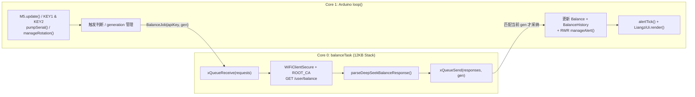

# `liangzi-meter` StickS3 旗舰级 UI 重构方案

> **适用项目**：`liangzi-meter`（M5StickS3 K150，`135×240` 竖屏 / `240×135` 横屏，8 MB OPI PSRAM，M5PM1 PMU，BMI270，ES8311 + 扬声器，250 mAh 电池）
> **当前状态**：已完成阶段 2 实施、纯 C++ 领域单测、真实 `M5GFX 0.2.26` 12 屏渲染像素核验与 StickS3 固件编译验收（`FW_VERSION "1.4.0"`）；待接入真机烧录做实机目视与串口联调
> **底层参考**：[ui-frameworks.md](../../kb/ui-frameworks.md)、[lib-m5gfx.md](../../kb/lib-m5gfx.md)、[m5stick-s3.md](../../kb/m5stick-s3.md)、[CONTEXT.md](../CONTEXT.md)、[ADR-0002~0006](./adr/0002-jsonl-serial-protocol.md)

---

## 1. 现状诊断与不可破坏硬约束

对照当前固件实现（[sticks3.ino](../sticks3/sticks3.ino) `v1.3.0`、[config.h](../sticks3/config.h)、[alert.h](../sticks3/alert.h)），现有功能逻辑稳定可靠，但视觉表现力、信息密度与流畅度仍有显著提升空间：

1. **视觉与字体瓶颈（锯齿 + 固底死图 + 高 Flash 占用）**：
   - 通篇使用 1-bit 硬边点阵字 `efontCN_12/16/24`（仅单 `efontCN` 字库就将当前固件 Flash 推至 **71%**）。
   - 「梁文峰 / 梁文谷」大字采用固底稀疏像素表 [peak_font.h](../sticks3/peak_font.h)，背景像素写死为纯色 `CLR_BG`，无法优雅叠放在圆角卡片、渐变流光条或细腻表面之上。
2. **同步 TLS 阻塞与交互闪烁**：
   - `manageBalance()` 中的 `bsClient.connect()` 同步执行 TCP+TLS 握手，在主循环 `loop()` 内阻塞 1–2 秒；开启 RWR 高峰 15 秒轮询后，动画与按键反馈会周期性卡顿。
   - 按 `KEY1` 手动刷新会立即清零 `balanceValid = false`，导致屏幕先闪成 `--` 再等待网络返回。
3. **API 与领域层高价值数据被大量丢弃**：
   - DeepSeek `GET /user/balance` 响应的 `balance_infos[]` 实际包含 **`granted_balance`（优先扣费赠金）**、**`topped_up_balance`（充值余额）**、**`currency`** 与 **`is_available`**，当前固件全部抛弃，也缺少余额变化历史趋势与单次波动 delta。
   - 领域层已经精准算出了 **`weekend`、`holiday`（含 2026 国务院放假表）与 `peak_ranges`**，以及 **RWR 高峰监控状态（ADR-0004）**，但当前屏幕上均无直观可视化呈现（缺少 24h 峰谷时间轴、节假日/周末低谷徽标与 RWR 监控脉冲指示）。
4. **调样式与多姿态验收效率低**：
   - 竖屏与横屏两套绘制逻辑与坐标硬编码在 `sticks3.ino` 里，与 Wi-Fi/NVS/串口耦合，缺少纯 C++ 单测与 PC 端真实 `M5GFX` 多姿态截图回归。

### 不可破坏硬约束

| 约束来源 | 必须严格遵守的契约 |
|---|---|
| **[ADR-0003](./adr/0003-peak-wording-liangwenfeng-deliberate.md) 与 [CONTEXT.md](../CONTEXT.md)** | 峰谷文案固定使用「**梁文峰**」（山字旁，琥珀金 `#FBBF24`）与「**梁文谷**」（翡翠绿 `#4ADE80`），这是刻意对仗而非错别字；**峰谷主色绝不使用红色**，红色（`#F87171`）专用于余额低于阈值告警、高峰 RWR 扣费告警与接口异常。 |
| **[ADR-0005](./adr/0005-gravity-auto-rotate.md)** | 保留 `screen_rotation`（0..3）、`auto_rotate` 与 BMI270 真机标定 1.5s 防抖映射；**横屏下峰谷大字主卡必须靠设备底部（USB 端）一侧**：`rotation 1`（90°）峰谷居右栏、`rotation 3`（270°）峰谷居左栏。 |
| **[ADR-0004](./adr/0004-alert-tones.md)** | 保留 Core 1 非阻塞 `alertTick()`、默认关闭、进入高峰一次性敌跟踪音、高峰 15s 轮询与扣费 `> 0.01` 持续敌导弹音语义。 |
| **[ADR-0002](./adr/0002-jsonl-serial-protocol.md) 与 [上位机](../host/src/liangzi_meter/ui.py)** | 保留 JSONL（`ping`/`hello`/`config`/`ack`/`get_state`/`state`）与 NVS `"lzcfg"` 键名 100% 兼容，不破坏已有 `host/` 工具；仅在 `state` 消息向后兼容地追加可选字段 `granted_balance`、`topped_up_balance`、`currency`、`balance_available`。 |
| **[ADR-0006](./adr/0006-connected-standby-over-deep-sleep.md) 与 [省电规格](../.scratch/power-saving/spec.md)** | 本轮不混入 `power_saving` 协议 v2 与上位机分页改造，但 `LiangziUi` 绝不擅自调用 `setBrightness()`，并内建自适应帧率与静帧跳过能力，确保后续无缝接入变暗与熄屏监控。 |

---

## 2. 技术选型与 4-bpp BFF 混合字体栈

结合 [ui-frameworks.md](../../kb/ui-frameworks.md) 的架构评审结论，本轮选定与 `minecraft-motd` 同源验证过的轻量化高性能技术栈：

> **渲染底座**：`M5GFX 0.2.26` 抗锯齿矢量原语 + PSRAM 双缓冲 `LGFX_Sprite` + **6 套无压缩 4-bpp BFF 混合字体栈**
> **动效引擎**：自包含阻尼弹簧（`SpringValue`）与三次缓动（`EasingValue`）
> **验证流**：纯 C++ `LiangziModel` 单元测试 + MSVC 原生调用本地 `M5GFX 0.2.26` 源码的多方向截图模拟器

### 2.1 4-bpp BFF 混合字体栈规划

已核实本地 `M5GFX 0.2.26` 源码（`lgfx_fonts.cpp:1392-1710`）：`lgfx::BFFfont` 通过 `mapCodepointToGlyph(uint32_t codepoint, ...)` 原生支持完整 **BMP Unicode（U+0000–U+FFFF）** 及 LVGL BFF 全部 4 种 cmap 格式（`format 0`、`sparse`、`format 0 tiny`、`sparse tiny`）。因此完全可以直接用 `lv_font_conv --bpp 4 --format bin --no-compress --no-kerning` 生成带 16 级抗锯齿 Alpha 通道的中英文与数字 BFF 字库，彻底告别黑底接缝与锯齿。

| 字体数组名 | 源 TTF（自动回退策略） | 字号 | 字符覆盖范围 | 预估 Flash | 用途 |
|---|---|---|---|---|---|
| `kFontHero36` | `msyhbd.ttc`（若 `lv_font_conv` 不认 `.ttc` 则自动回退 `Dengb.ttf`） | 36 px | `梁文峰谷`（4 字） | ~3.5 KB | 竖屏（135×240）Page 0「梁文峰 / 梁文谷」大字 |
| `kFontHero30` | 同上 | 30 px | `梁文峰谷`（4 字） | ~2.6 KB | 横屏（240×135）Page 0「梁文峰 / 梁文谷」大字（总宽 ~90px 适配 111px 半屏卡） |
| `kFontCn12` | 同上 | 12 px | ASCII `0x20-0x7E` + `¥°·` + 精选 ~160 固定 UI 汉字 | ~18 KB | 全界面中文标签、状态胶囊、星期、24h 说明与诊断标签 |
| `kFontMeta10` | `segoeuib.ttf` | 10 px | ASCII `0x20-0x7E` + `¥°·` | ~2.4 KB | `2x` / `1x` / `RWR` / `15s` / `5m` / `00..24` 刻度与微标 |
| `kFontNum16` | `consolab.ttf` | 16 px | `0-9 . , : - + ¥ $ / %` | ~2.5 KB | Tabular 等宽倒计时 `02:14:38`、赠金/充值分项数、超万余额降级字号 |
| `kFontNum22` | `consolab.ttf` | 22 px | `0-9 . , - + ¥ $` | ~2.6 KB | Tabular 等宽主余额大字 `¥110.00` |
| `efontCN_12` | M5GFX 内置 | 12 px | 全 CJK | 已内置 | **仅用于**任意 UTF-8 `cfg.ssid`（用户自填 Wi-Fi 名称）兜底显示 |

> **自动覆盖校验与 Flash 收益**：`tools/gen_fonts.py` 会静态扫描 `LiangziUi.cpp` 内所有非 ASCII 字符串字面量，强制断言 100% 汉字都已包含在 `kFontCn12` 字符表里，防止烧录后出现缺字方块；同时移除 `efontCN_16`、`efontCN_24` 与 25 KB `peak_font.h` 后，固件整体 Flash 预计可从 **71% 降至约 50–55%**。

---

## 3. 数据层升级与 Core 0 异步架构

### 3.1 DeepSeek `/user/balance` 完整解析与资金拆分

官网 `GET https://api.deepseek.com/user/balance` 标准返回结构如下：

```json
{
  "is_available": true,
  "balance_infos": [
    {
      "currency": "CNY",
      "total_balance": "110.00",
      "granted_balance": "10.00",
      "topped_up_balance": "100.00"
    }
  ]
}
```

- **解析策略（纯 C++ `parseDeepSeekBalanceResponse()`）**：
  - 记录 `httpStatus`（例如 `200`、`401`、`504`）供 Page 2 诊断展示；
  - 解析 `is_available`；在 `balance_infos[]` 中优先挑选 `currency == "CNY"` 的条目（若无则回退索引 `0`）；
  - 提取 `total_balance`、`granted_balance`（赠金，DeepSeek 实际扣费优先消耗赠金，后扣充值）与 `topped_up_balance`（充值）；当部分兼容网关缺少 `granted_balance`/`topped_up_balance` 时安全置为 `hasSplit = false`，UI 自动降级不出错。
- **单次变化与 40 点历史环形缓冲区（`BalanceHistory`）**：
  - 记录最近 40 次成功采样 `{ double total; double granted; double toppedUp; uint32_t atMs; bool inPeak; bool decreased; }`；
  - 计算 `lastDelta`（相对上次成功采样的变化量，持续展示最近一次显著变化方向）、`minTotal`、`maxTotal`、`sessionDelta`、`burnCount`（扣费点计数）。

### 3.2 五态峰谷模型与 24 小时进度

扩展 `PhaseKind` 枚举与时段计算（与既有 2026 国务院放假表 `isChinaPublicHoliday` 与自定义 `peak_ranges` 跨午夜逻辑完全同源）：

- `PhaseKind::kUnsynced`：时间未同步
- `PhaseKind::kPeak`：高峰期 · `2x`（显示「梁文峰」，琥珀金）
- `PhaseKind::kOffPeakWorkday`：工作日低谷 · `1x`（显示「梁文谷」，翡翠绿）
- `PhaseKind::kOffPeakWeekend`：周末全天低谷 · `1x`（显示「梁文谷」，翡翠绿）
- `PhaseKind::kOffPeakHoliday`：法定节假日低谷 · `1x`（显示「梁文谷」，翡翠绿）

同时前向/后向搜索当天与邻近边界，计算当前时段已走过比例 `phaseProgress`（0.0–1.0），在 24h 时间轴上实时标出当前时刻游标与高峰色块。

### 3.3 Core 0 FreeRTOS 异步请求流水线



- **彻底消灭主循环卡顿**：`WiFiClientSecure` 只在 Core 0 的 `balanceTask` 内创建与回收，TLS 1–2s 握手与网络读响应与 Core 1 完全并行；Core 1 在轮询期间依然可维持 35–40 FPS 顶栏扫光动画与 0 延迟按键响应。
- **`generation` 竞态隔离**：当上位机下发新配置修改 `api_key` 或 `wifi` 时，Core 1 自增 `generation` 并置丢弃标志，Core 0 即使刚刚完成一次旧 key 的请求也会被安全忽略并立即触发新 key 查询。

---

## 4. Obsidian Desk-Instrument 视觉设计系统

### 4.1 调色板规范

| 语义角色 | Hex 色值 | 用途约束 |
|---|---|---|
| `kBgBase` | `#090D12` | 全局黑曜石底色 |
| `kCardBg` | `#121A23` | 抬升圆角卡片底色（`r = 7`） |
| `kWellBg` | `#0D141C` | 图表凹槽、24h 时间轴轨道、键帽槽底色 |
| `kCardBorder` | `#1F2E3D` | 1px 柔和卡片描边 |
| `kPillBg` | `#182330` | 状态胶囊与键帽底色 |
| `kTextPrimary` | `#EEF4F8` | 主金额、倒计时与当前时间 |
| `kTextSecondary` | `#B8C7D6` | 次级摘要信息 |
| `kTextMuted` | `#7A8FA3` | 辅助标签、刻度与元信息 |
| `kPeakAmber` | `#FBBF24` | 高峰期「梁文峰」大字、主卡顶部 2px 流光条、24h 高峰段（ADR-0003） |
| `kOffEmerald` | `#4ADE80` | 非高峰「梁文谷」大字、主卡顶部 2px 流光条、正常态/低谷段（ADR-0003） |
| `kWarnRed` | `#F87171` | **唯一红色用途**：低于阈值余额文字/红框、RWR 扣费导弹告警脉动、异常状态 |
| `kCyan` | `#38BDF8` | 查询中顶边 2px 扫光、充值余额段、`[A]` 刷新反馈 |
| `kViolet` | `#A78BFA` | 赠金（`granted_balance`，优先消耗）区分色 |

### 4.2 程序化矢量微图标与语义徽章

- **Wi-Fi 弧图标（12×10 px）**：根据 RSSI（`> -60 / -75 / -90 dBm`）三级点亮圆弧；断线时暗灰带斜杠。
- **电池与充电胶囊（26×11 px）**：圆角电池外框 + 内部电量进度条 + 百分比文本；`M5.Power.isCharging()` 为真时胶囊染翠绿并叠加精致闪电角标。
- **状态与 RWR 徽章**：
  - 常态左胶囊：`● 高峰 2x` / `● 低谷 1x` / `● 周末谷` / `● 假日谷` / `● 未同步`。
  - 开启提示音且身处高峰监控时：主卡右上显精简 `RWR 15s` 徽章；若触发 `mslAlertActive`（扣费持续告警），顶栏与余额卡同时进入呼吸红框 + `RWR 扣费` 脉冲，同时严守 ADR-0003 保持「梁文峰」文字仍为琥珀金。

---

## 5. 竖屏 `135×240` 与横屏 `240×135` 三页像素级布局

### 5.1 全局 Chrome（三页共享）

- **Top Bar**：
  - 竖屏（`y: 0..18`，高 19 px）：左侧态胶囊（`高峰 2x`/`低谷 1x`/`周末谷`/`假日谷`）+ RWR 脉冲点；右侧 Wi-Fi 信号弧 + 电池百分比胶囊。
  - 横屏（`y: 0..16`，高 17 px）：左侧状态胶囊 + **居中 `HH:MM:SS MM-DD 周X`**（紧凑高可读）+ 右侧 Wi-Fi 信号弧 + 电池百分比胶囊。
  - **顶边 `y: 0..1`**：正在查询余额（`queryBusy == true`）时，42 px 宽 `kCyan` 流光条匀速来回穿梭。
- **Footer**：
  - 竖屏（`y: 221..239`，高 19 px）：左侧 `[A] 刷` 键帽 + 居中 **弹簧药丸 3 页指示器**（当前页拉长 12×4 圆角药丸，其余页 4×4 圆点）+ 右侧 `[B] 页`。
  - 横屏（`y: 120..134`，高 15 px）：左侧 `[A] 刷新` + 居中弹簧药丸指示器 + 右侧刷新龄（如 `12s前`）与 `[B]`。
  - **底边 2 px 细条**：平常按 `5m`、RWR 高峰监控按 `15s` 平滑推进下次自动查询倒计时进度条。

### 5.2 三大页面设计（短按 `KEY2` 横向弹簧切换）

#### Page 0：峰谷与余额主仪表（Cockpit）

```text
竖屏 135×240 (rotation 0 / 2)               横屏 240×135 (rot 1: 峰谷居右 / rot 3: 峰谷居左)
┌─────────────────────────┐ y=0..18         ┌─────────────────────────────────────────────┐ y=0..16
│ ● 高峰 2x     WiFi 84%⚡│ ──(2px青色扫光) │ ● 高峰 2x    14:32:08 08-18周二   WiFi 84%⚡│
├─────────────────────────┤ y=20..34        ├─────────────────────┬───────────────────────┤ y=19..116
│ 08-18 周二     14:32:08 │                 │ 可用余额      -0.18 │ ═══════(2px琥珀流光)  │
├─────────────────────────┤ y=37..134       │                     │ 当前高峰 · 2x   [RWR] │
│ ═══════(2px琥珀流光)════│                 │      ¥110.00        │                       │
│ 当前高峰 · 2x     [RWR] │                 │                     │       梁 文 峰        │
│                         │                 │ ████▓▓▓▓▓▓▓▓▓▓▓▓▓▓▓ │                       │
│        梁 文 峰         │                 │ 赠 10.0 · 充 100.0  │     剩余 02:14:38     │
│                         │                 │                     │ ━━━🟨━━🟨━━━━●━━━━━━━ │
│     剩余  02:14:38      │                 ├─────────────────────┴───────────────────────┤ y=119..134
│ ━━━🟨━━🟨━━━━●━━━━━━━━━ │ (24h时间轴)     │ [A] 刷新       ●──  ○  ○         12s前  [B] │
├─────────────────────────┤ y=138..217      └─────────────────────────────────────────────┘ (2px查询进度条)
│ 可用余额          -0.18 │
│        ¥110.00          │
│ ████▓▓▓▓▓▓▓▓▓▓▓▓▓▓▓▓▓▓▓ │ (赠金/充值条)
│ 赠 10.00      充 100.00 │
├─────────────────────────┤ y=221..239
│ [A]刷   ●── ○ ○   [B]页 │
└─────────────────────────┘ (2px查询进度条)
```

- **峰谷主卡**：
  - 顶部 2 px 语义流光条（高峰琥珀金 / 低谷翡翠绿），副标题明确标出 `当前高峰 · 2x`、`周末全天 · 1x` 或 `法定假日 · 1x`。
  - 中央居中 `kFontHero36`（竖屏）/ `kFontHero30`（横屏）渲染「梁文峰」或「梁文谷」。
  - 倒计时行使用 `kFontNum16` 等宽数字，低谷遇到连续周末/节假日时如 `71:28:12` 或超过 99h 显示 `153h41m` 自动防溢出。
  - **内嵌 24h 时间轴轨道**：显示全天背景、`peak_ranges` 琥珀色高峰块（节假日/周末整条柔和翠绿低谷），以及代表当前时刻的亮点游标。
- **余额主卡**：
  - 标题行右侧动态显示最近变化量徽章（如 `-0.18`、或失败降级时的琥珀 `旧` 徽章）；数值小于 `balanceWarn` 时余额文字与卡片描边变 `kWarnRed`。
  - 底部双色迷你条按 `granted / (granted + toppedUp)` 比例铺陈 **紫（赠金优先）+ 青（充值）**，下方简明显示 `赠 10.00` 与 `充 100.00`。
- **出厂未配置态（`!hasWifi`）**：Page 0 显示居中 USB 配网引导卡（含呼吸 USB 联机图标与「连接 USB 运行上位机配置」提示），短按 `KEY2` 仍可切换到 Page 2 查看固件版本、方向与传感器/Wi-Fi 状态。

#### Page 1：余额构成与 40 点消耗趋势（Balance Split & Burn Trend）

```text
竖屏 135×240                                横屏 240×135
┌─────────────────────────┐                 ┌───────────────────────┬─────────────────────┐
│ 资金构成       CNY·可用 │                 │ 资金构成     CNY·可用 │ 消耗趋势(40)  -1.42 │
│ 赠金(优先)       ¥10.00 │                 │ ████████▓▓▓▓▓▓▓▓▓▓▓▓▓ │    ╲                │
│ 充值余额        ¥100.00 │                 │ 赠 ¥10.00   充 ¥100.0 │     ╲──╲            │
│ ████▓▓▓▓▓▓▓▓▓▓▓▓▓▓▓▓▓▓▓ │                 │ 阈值 ¥10.0  可用 √    │         ╲───● (红点)│
├─────────────────────────┤                 └───────────────────────┴─────────────────────┘
│ 消耗趋势(40)      -1.42 │
│                         │
│ ╲                       │
│  ╲──╲                   │
│      ╲────╲──────●      │
│ 采样 18次       15s监控 │
└─────────────────────────┘
```

- **折线鲁棒性规则**：
  - 有效历史 `count >= 2` 且 `maxTotal - minTotal > 0.005` 时：按上下留白归一化，`drawWideLine(1.6px)` 绘制青色/绿色抗锯齿曲线与底部半透明渐变；对发生扣费（`decreased == true`）的采样节点叠加红色圆点，并在末点标注实心光标。
  - 若期间余额完全无变化（`maxTotal - minTotal <= 0.005`）：强制在画布中轴渲染柔和翠绿稳态水平线并标注 `余额持平`，**避免 y 轴除零塌陷**。
  - 采样 `< 2` 点：显示居中等待第二次采样占位文字与当前轮询周期（`5m` 或 `15s`）。

#### Page 2：今日 24h 排班与系统诊断（Schedule & System）

```text
竖屏 135×240                                横屏 240×135
┌─────────────────────────┐                 ┌─────────────────────────────────────────────┐
│ 今日排班         工作日 │                 │ 今日排班 · 工作日      09:00-12 · 14:00-18 │
│ ━━━🟨━━🟨━━━━●━━━━━━━━━ │                 │ ━━━━━━━🟨🟨━━━━━━🟨🟨━━━━●━━━━━━━━━━━━━━━ │
│ 00   06   12   18   24  │                 │ 00       06       12       18          24 │
│ 高峰: 09-12 · 14-18     │                 ├──────────────────────┬──────────────────────┤
├─────────────────────────┤                 │ WiFi  MyHomeNet (-58)│ RWR  开启 · 15s监控   │
│ WiFi  MyHomeNet  -58dBm │                 │ IP    192.168.1.42   │ 阈值 ¥10.0 · HTTP 200│
│ IP    192.168.1.42      │                 │ NTP   ntp.aliyun.com │ 方向 90°固定 · v1.4.0│
│ NTP   ntp.aliyun.com    │                 └──────────────────────┴──────────────────────┘
│ RWR   开启 · 15s监控    │
│ 阈值  ¥10.00 · HTTP 200 │
│ 方向  90° 固定 · v1.4.0 │
└─────────────────────────┘
```

- `WiFi SSID` 渲染显式切到内置 `&fonts::efontCN_12`，保障任意中文/emoji 之外常见 UTF-8 SSID 不丢字，其余所有标签走 4-bpp 抗锯齿 `kFontCn12`。

### 5.3 按键交互升级

- **短按 `KEY1`（A 键）**：
  - 不清空当前有效余额；立即触发 `ui.triggerPulse(now)`，顶栏 2px 青色光柱快速脉动一次，并向 Core 0 投递立即查询请求。
- **短按 `KEY2`（B 键）**：
  - 在 `Page 0 (主仪表) → Page 1 (趋势) → Page 2 (排班与诊断) → Page 0` 之间触发无回弹单调平滑滑入切换（`easeOutCubic`, `200 ms`）。
- **长按 `KEY2`（700 ms）**：
  - 按住超过 150 ms 后浮出居中半透明遮罩与抗锯齿弧形蓄力环（`fillArc`, `0° → 360°`）；
  - 满 700 ms 瞬间：若 `cfg.autoRotate == false`，顺时针切换到 `(curRotation + 1) % 4`、持久化进 NVS、调用 `ui.onResize()` 并通过串口主动补发一次 `state`；若 `cfg.autoRotate == true`，保持重力自动方向不强行改配，弹出 1.5s 顶部 Toast 提示「自动旋屏已开」。

---

## 6. 动效规格、自适应帧率与资源预算

### 6.1 动效参数

| 动画对象 | 数学模型 | 参数 | 视觉体验 |
|---|---|---|---|
| `pageScroll_` | `EasingValue` | `easeOutCubic, 200 ms` | 无回弹、无过冲的干脆滑入切页 |
| 底栏胶囊宽/位置 | 随 `pageScroll_` 同步计算 | `pageScroll_.value()` | 平滑指示当前页，不来回震荡 |
| `splitReveal_` | `EasingValue` | `easeOutCubic, 320 ms` | 新余额数据到达时赠金/充值堆叠条展开 |
| `pulseUntil_` / `busySweep` | 线性周期函数 | `650 ms / 750 ms` | KEY1 脉冲与 Core 0 查询顶边青光穿梭 |
| `holdBProgress` | 实时占比 | `150..700 ms` | 长按 KEY2 旋屏蓄力圆环与角度预演 |

### 6.2 自适应帧率策略（兼顾 40 FPS 丝滑与省电衔接）

`LiangziUi::recommendedFrameIntervalMs(model, nowMs)` 动态判定：
- **活跃态（`25 ms`，约 40 FPS）**：当 `EasingValue` 仍在收敛、`queryBusy == true`（顶栏扫光）、RWR 导弹告警闪烁中、KEY1 脉冲未消退、`holdBProgress > 0` 或 Toast 展示中。
- **静态态（`500 ms` 调度 + 帧指纹脏检查）**：所有动画收敛且无实时扫光时，每 500 ms 检查一次秒级时钟/倒计时数字；仅当视觉状态真实发生变化（例如跨秒）时才向屏幕执行 `pushSprite()`，不产生无效 SPI 刷新。

### 6.3 StickS3 内存与 Flash 预算

| 资源项 | 预算 | 存放位置 | 说明 |
|---|---|---|---|
| 主合成画布 `canvas_` | 64,800 B（`135×240×2` 或 `240×135×2`） | 8 MB OPI PSRAM | 旋转时通过 `onResize()` 就地重建，防内部 SRAM 碎片 |
| 6 套 4-bpp BFF 字体 | ~32 KB | Flash | 远小于淘汰掉的 `efontCN_16/24` + `peak_font.h` |
| 40 点 `BalanceHistory` | ~1.3 KB | 内部 SRAM | 定长循环数组，零堆碎片 |
| Core 0 `balanceTask` 栈 | 12,288 B | FreeRTOS 堆 | 独立承载 `WiFiClientSecure` mbedTLS 握手与解析 |
| 预计总固件大小 | ~1.65–1.80 MB / 3.2 MB | StickS3 默认 8MB App 分区 | 预计比重构前的 71% 降低 **15–20 个百分点** |

---

## 7. 三层解耦目录与两阶段验收清单

```text
liangzi-meter/
├── lib/
│   └── LiangziUi/
│       ├── library.properties
│       └── src/
│           ├── LiangziAnim.h     ← Spring / Easing / RGB 工具（零外部依赖）
│           ├── LiangziModel.h/cpp← 纯 C++：API解析 / 24h峰谷假日 / 40点历史 / RWR辅助
│           ├── LiangziFonts.h    ← gen_fonts.py 生成的 6 套 4-bpp BFF C 数组
│           └── LiangziUi.h/cpp   ← 只依赖 LovyanGFX 的竖/横双布局三页 HUD 引擎
├── sticks3/
│   ├── sticks3.ino               ← Core 0 查询任务 + Core 1 按键/串口/IMU/RWR 音频 + LiangziUi
│   ├── config.h                  ← NVS "lzcfg" 持久化与 Config 定义
│   ├── alert.h                   ← ADR-0004 RWR 提示音状态机
│   └── certs.h                   ← DigiCert Global Root G2
├── tools/
│   ├── gen_fonts.py              ← lv_font_conv BFF 生成 + UI 汉字 100% 覆盖自检
│   ├── native-test/              ← MSVC 纯 C++ 领域单测
│   └── ui-sim/                   ← MSVC + 本地真实 M5GFX 0.2.26 源码多方向截图导出器
└── docs/
    ├── adr/
    └── ui-redesign.md            ← 本设计文档
```

### 分阶段验收命令与实测结果（阶段 2 已完成）

1. **阶段 1（已完成）**：设计文档 + 交互式 HTML 原型观感确认，JS 语法静默核验。
2. **阶段 2（已全部验证通过）**：
   - **字体生成与 `M5GFX` cmap 归一化修复**：`python liangzi-meter\tools\gen_fonts.py` → exit 0。实测发现 `lv_font_conv` 输出的 `cmap` 块头相对偏移会导致 `M5GFX 0.2.26`（`lgfx_fonts.cpp:1199-1217`）在查找表 >8B 时出现 `pv == rv` 平局而错位 +8B；已在 `gen_fonts.py` 中自动转为负载相对偏移并用完全复刻 `M5GFX::mapCodepointToGlyph()` 验证全部字符有效，6 套 BFF（`Dengb.ttf`、`segoeuib.ttf`、`consolab.ttf`）合计仅 **22,688 bytes**，UI 汉字覆盖 **100%**。
   - **纯 C++ 领域单测**：`cmd /c liangzi-meter\tools\native-test\build.cmd` + `liangzi-meter\.build\native\native-test.exe` → `PASS: LiangziModel native-test (61 assertions)`（覆盖 2026-11-21 核实的官方峰谷定价、2026 + **2027 年国务院 10 号放假与调休规则**、分块 HTTP/JSON 余额拆分、40 点历史与 RWR 判决边界）。
   - **真实 `M5GFX 0.2.26` 多姿态截图审计**：`cmd /c liangzi-meter\tools\ui-sim\build.cmd` + `liangzi-meter\.build\native\ui-sim.exe --dump-dir liangzi-meter\.build\ui-preview` → 导出竖屏 6 帧 + 横屏 6 帧，完成逐像素肉眼审计（覆盖 `rot 1/3` USB 侧镜像、中英文混排、40 点趋势与持平曲线、`RWR扣费` 脉冲、长按蓄力环、`自动旋屏已开` Toast）。
   - **StickS3 固件编译与 LF 校验**：
     `arduino-cli compile --libraries ./liangzi-meter/lib --libraries ./lib --fqbn m5stack:esp32:m5stack_sticks3 --build-path ./liangzi-meter/.build/firmware ./liangzi-meter/sticks3` → exit 0。
     - **Flash**：**`1,553,055` bytes（46%）** / `3,342,336` bytes（从旧版 71% **下降 25 个百分点**，节省约 820+ KB）
     - **RAM**：**`52,912` bytes（16%）** / `327,680` bytes（剩余 `274,768` bytes）
     - `sticks3.ino` 严格 LF（`CR = 0`），且上位机 `host/src/liangzi_meter/*.py` `py_compile` exit 0。
